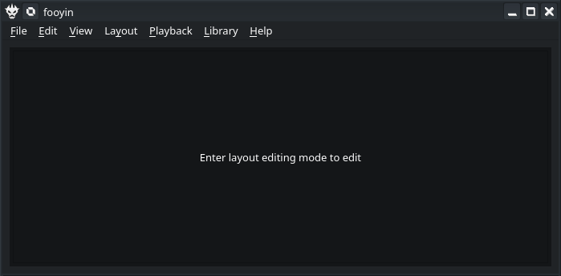
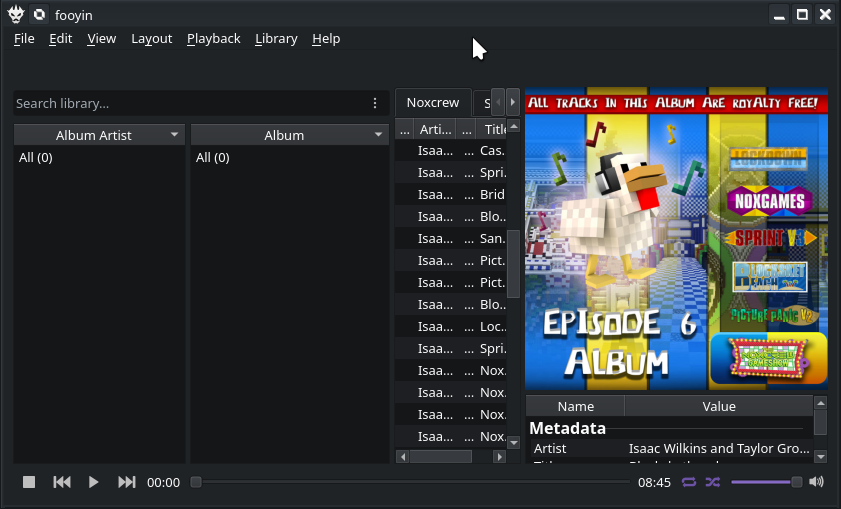
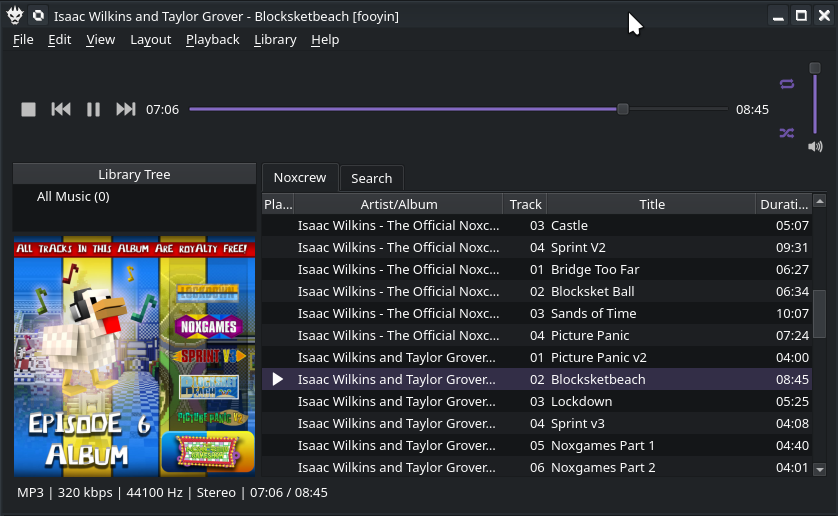
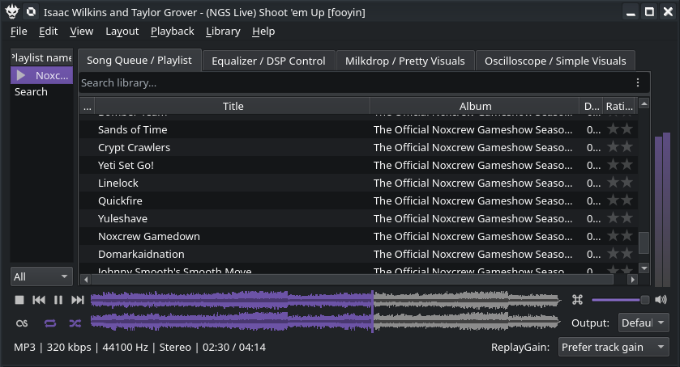
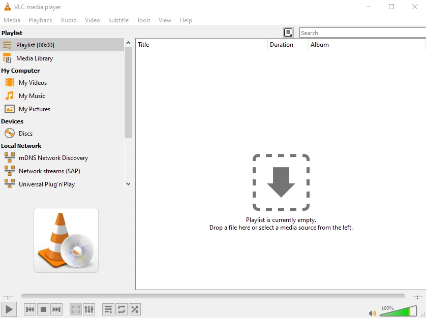
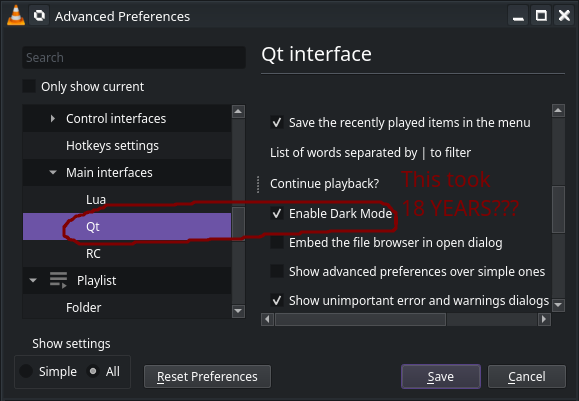

There's much ado over which listening app you should use to listen to music in 2026. I have my own favorites, you have yours, everyone's different, obviously that means you need to talk over someone's ears until they start listening to you! In this case, I'm talking about the various different ways I listen to my music, along with my "dream music app" that I want to build or have built.

# 'Build it yourself! Good luck!' - Fooyin
Fooyin is a customizable music player that doesn't have an interface. It's great, it's simple (in a way), and it does everything an audio player needs to do.It supports OGG's, MP3's, you can load additional codecs into it as needed, and it optimizes its memory usage so you never end up starved for RAM during the more demanding scenarios like streaming to friends or the newest triple-A games. It's got some hang-ups, though, such as the fact it has no interface.

At least, not in the typical way - if you choose to not start with an interface at all during the initial setup, this rather ominous blank space is what greets you when you finish going through the rest of the library setup screens:

*Rather lackluster, isn't it? So much blank space, and not a play button in sight...*

Part of that is because fooyin comes with several default gadget layouts to help you get started setting up and listening to your music. For instance, the following layout is named "Obsidian", and is supposed to be focused on your music library, based on the Apple Music player circa 2019. But as you'll see, that doesn't appear to be the case for people with small window real-estate.

*OK, now we have basic player controls, but why is the track list so squished? Why is a third of the window dedicated to album art? A whole lot of "why" with this setup...*

We can fix it a little by trying to abandon the "new modern music player" look, but even in the default "Simple" layout there appears to be more dedication to the album art then to making things maintainable!

*That's a little better, but now the player controls are on top. And they take up almost a fourth of the window! And what if had a lot of albums?!*

I've tried to fix this by [creating my own layout with all the pretty gizmos and widgets](https://commandhat.com/projects/alephglue/), but this still demonstrates the problem with apps similar to fooyin: For an engineer, building your own music player is a dream. For everyone else, good luck with the struggle!

*Holy information density, batman! At least I can reach everything I need on this screen… I think.*

I'm sure there's a few things lacking from it, too. Being a digital music nerd, I've always preferred pretty visuals, so I never prioritized building the album art into the screen. Why do you need to be reminded which album you're listening to when a few words can serve the same purpose? I mean, if you have two albums, one of the Beatles and then someone trying to copy The Beatles, *maybe* the album art would help, but seeing "Ripoff Beatles" as the current album vs. "The Beatles" would be pretty definitive and convey the same information in less time, while also taking less screen space.

And yes, I'm aware there's a Mac OS 'Command button' icon next to the volume. That's the mute button; but layouts don't save custom icons to those, so I have to right-click it and fix it myself whenever I reload the layout file. 

# 'If You Want It So Much, Hire a Developer' - VLC
VLC has a few of the functions I desire that make it occasionally helpful. But if the mainline app is missing something you want, either develop a plugin, fork the source code and risk missing security updates from there on out, or just forget about it.

For a while, VLC didn't even *have a dark theme!* The following eyesore is what you were greeted with when you wanted some tunes to wake you up at 6AM before the sun crossed the horizon… or at 8PM at night, when you need some slower tunes to please your sleepy brain before bed. 
 
*A moment of silence for those who just scrolled past super quickly and got flashbanged by this image. May their eyes rest in peace.* 

Thankfully, with the release of 3.0.22 they fixed this and now you can go into the options to force a darker theme that won't destroy your corneas at three in the morning. It only took them *[eighteen years](https://github.com/pratikpatel8982/vlc-dark)* to finish the feature request, a world record for them! It's not like you can take advantage of the Qt skinning engine you're already using to implement a native dark theme, right? … right?

*It took them EIGHTEEN YEARS to figure out how to tell Qt to put dark colors in front of a light colorset???*

I'm sure you can feel the resentment coming through the above edited screenshot.

That's just some of the many shortcomings of this app. For example, VLC has long since relied on ffmpeg for reliable playback on NVidia videocards through Linux. That's all fine and dandy, but if you happen to have [problems installing ffmpeg](https://knockout.chat/thread/83991/17#post-3024975), VLC will suddenly and silently fail to play any video at all. The only way you'd be able to figure out anything is if you'd figured out that the ffmpeg section in Advanced Preferences -> Input/Codecs -> Video Codecs -> ffmpeg, had dissappeared without a trace. VLC doesn't even crash when this happens; it just freezes the UI eternally and continues playing *only* the audio; you need to SIGKILL the app to get another shot at figuring out what went wrong.

That's not even the only thing wrong with VLC: If you have a playlist and the files in that playlist dissappear (for instance, because you unplugged the USB drive holding them by accident), VLC will pop up the Log window with errors warning that it can't read a file. It'll then automatically skip the file, helpfully, and try to play the next one… Which it then also cannot read, popping up the log window and stealing focus from whatever window was on top, such as the "Close VLC?" confirmation box. It'll then auto skip to the next file, and continue this ad infinitum. You cannot click any buttons to stop this, either, as the Log window gives itself Modal priority on error, which prevents you from clicking anything else inside VLC. The only way to stop this is to either, have a ten second media file already in your playlist that you can guarantee VLC can read as that's the only way to get enough time to close the Log window and ALSO hit Pause/Stop, OR to SIGKILL the app using something like htop, as the focus stealing doesn't take away your keyboard input. Which would be easy if you happened to make sure VLC wasn't fullscreened, and left the window small enough you could still see the console. Because stealing focus means it auto-raises itself above everything, including your htop console session.

Truly, nothing comes for granted with this program.

# My Dream App - Radiocore
I imagine that someday someone will want to write their own music app. That someone might even be me. For the future, here's what I would want in such an app.

* Play Conditions & Schedules. You set one or more conditions on the song, and the song will be automatically skipped *unless* all the conditions are true. For example, you could set a condition allowing the music to only automatically play from 6 AM to 8 AM on Monday to Friday. Then you could set up a morning mix consisting of gentle music to get your brain out of its slow funk and into your work mood, and that calm music won't be able to suddenly jump in the middle of your workout session when you need pumping house jams to get you through your 30 reps of weightlifting.
* Sub-playlists. As above, the whelms of Shuffle All or Shuffle Album feel like going too far to one extreme or the other. If I get stuck without access to my phone, I'm stuck hearing let's say The Beatles on loop until I can get my hands on the interface. Either that, or I go from Yellow Submarine to death metal with zero warmup time in the middle of handling work items. To fix that, you can pick an album and import it as a sub-playlist. Then you can set a condition that each song can play at most once, or at most five items from this album will play at once. Then the shuffle algorithm will continue skipping until it exits the sub-playlist, and whatever is up next is up to the whims of my condition list.
* Feels & Moods. As above, you can tag your music however you like, but the only way to group like music together is to create playlists. Which for most people works fine, but I want something more specific. For example, [this jazzy MEGALOVANIA remix](https://www.youtube.com/watch?v=XWsvqvrZvqI) involves all the same instruments and has a slower beat that would technically match the category, but there's no sane person in the world today that would put it together with [actual smooth jazz music](https://www.youtube.com/watch?v=My-s5cgaM5M). Having automatic playlists categorized by moods I set, without the overhead of having two million playlists, would allow me to cue up slow music early in the day, finish work strong with pumpin' music, go from there to house music to keep pace at the gym, and finish the evening with some quiet plucking at a piano to send me back to sleep in the evening.
* Interruptions & Ads. My fiancee loves my music collection. No, really: She demands I sync up my music with her phone, *and* wants me to occasionally drop in a "special studio announcement" here and there so she can hear my voice during her workday. This feature is a natural extension of the Play Conditions & Schedules feature request above: Every so often (say, five tracks), the music stream can be interrupted by [a set of sound files](https://www.youtube.com/watch?v=Shgmo9NJS6M) that you can pick from. That way, your music library becomes a radio station that wouldn't feel out of place streamed to your car radio. Optionally, a pair of buttons – one to toggle the live mic and one to signal to the radio that the next time the song ends it should go to the live mic instead of another song – would be wonderful as well.
* Basic Equalizer and Filters. This is more for the rare times when I need to have music playing for an event I'm hosting or maintaining, but a small equalizer to cancel bad bands and enhance the good bands is a must-have. It makes using someone else's awful radio where the bass is blasted out of proportion, actually doable and fun. A few basic filters like reverb would enhance the experience as well, especially using cheap AUX repeaters or bluetooth speakers, to help lower the feeling of "I need to finish these last few units and then I can put my AirPods back in".

That's very overblown for a music app, but I promise you'd be able to sell the result, potentially as a subscription. I know I'm not the only one that wants to turn their music collection into a personalized radio station that comes from their phone instead of the airwaves.

At the very least, I'd subscribe to it.

